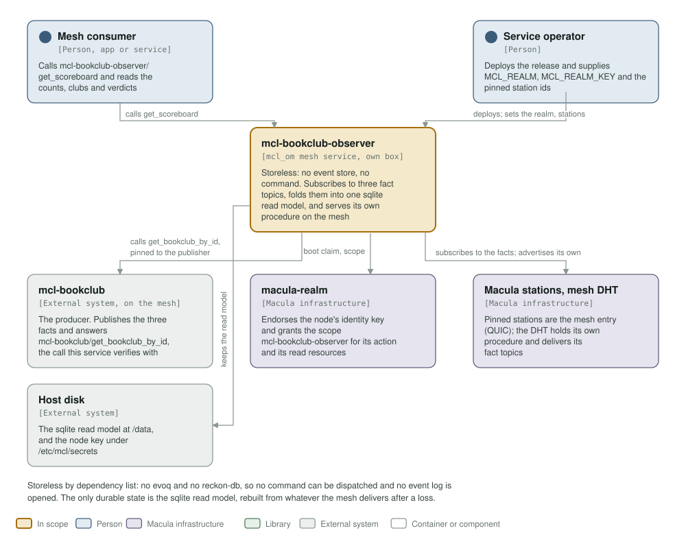
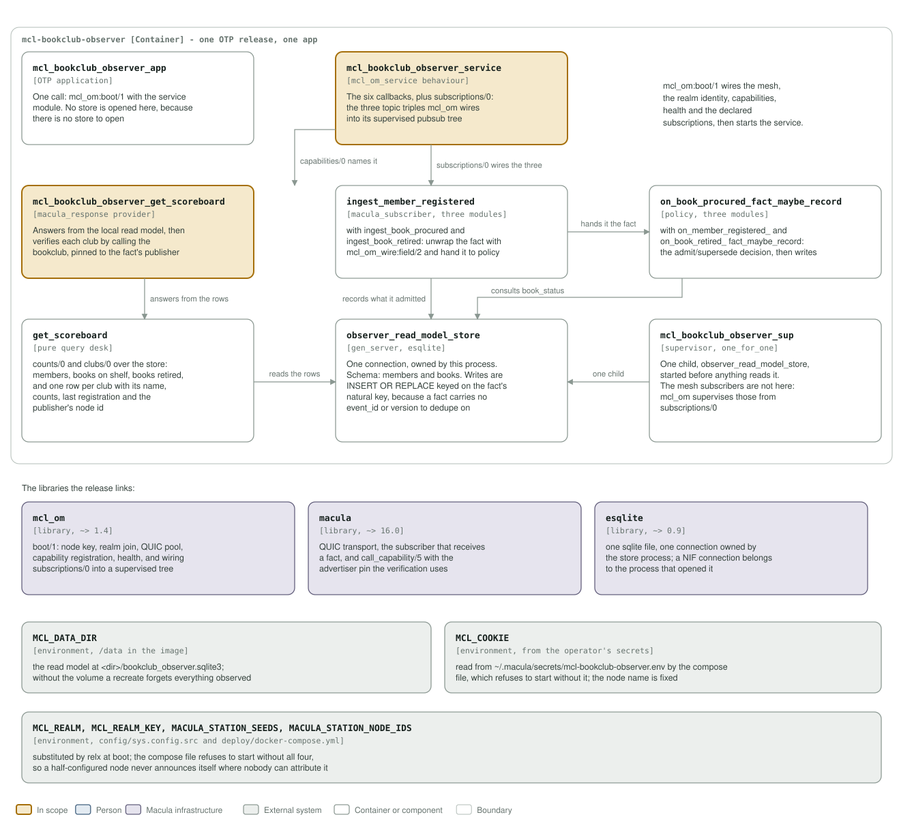

# mcl-bookclub-observer architecture: C4 model

*This exists so a reader can see what mcl-bookclub-observer talks to, and what it
is made of, without reading it.*

**Status: first version, end to end.** A storeless mesh service: it declares three
subscriptions, folds every fact it receives into one sqlite read model through a
listener and a policy per fact kind, and serves one procedure of its own,
`mcl-bookclub-observer/get_scoreboard`, which answers locally and then verifies
each club over the mesh. `mcl-om` adds `mcl-bookclub-observer/info` and
`mcl-bookclub-observer/get_limits` to every service, both open, and
`capabilities/0` is the list. It owns no event store and dispatches no command.

## Level 1: system context

| Element | Kind | Role |
| --- | --- | --- |
| mcl-bookclub-observer | In scope | Subscribes to the fact topics, folds them into one sqlite read model, and serves `mcl-bookclub-observer/get_scoreboard` on the mesh. `/health` is on a Unix socket |
| Mesh consumer | Person | Another service or app on the mesh that calls the scoreboard and reads the counts, clubs and verification verdicts |
| Service operator | Person | Deploys the release and supplies `MCL_REALM`, `MCL_REALM_KEY` and the pinned station ids |
| mcl-bookclub | External system | The producer. Publishes the three facts and answers `mcl-bookclub/get_bookclub_by_id`, the call this service verifies with |
| macula-realm | Macula infrastructure | Endorses the node's identity key and grants the scope `mcl-bookclub-observer` for its action and its read resources |
| Macula stations, mesh DHT | Macula infrastructure | The pinned stations are its mesh entry points over QUIC; the DHT holds its own procedure's advert and delivers its fact topics |
| Host disk | External system | The sqlite read model under `/data`, and the node identity key under `/etc/mcl/secrets` |

Storeless by dependency list: there is no `evoq` and no `reckon_db` in
`rebar.config`, so no command can be dispatched and no event log is opened. The
only durable state is the sqlite read model, rebuilt from whatever the mesh
delivers after a loss.

## Level 2: containers and components

| Component | Technology | Responsibility |
| --- | --- | --- |
| `mcl_bookclub_observer_app` | OTP application | One call: `mcl_om:boot/1` with the service module. No store is opened, because there is no store to open |
| `mcl_bookclub_observer_service` | the `mcl_om_service` behaviour | The six callbacks, plus `subscriptions/0`: the three topic triples `mcl_om` wires into its supervised pubsub tree. `health/0` pings the read model store |
| `mcl_bookclub_observer_get_scoreboard` | `macula_response` provider | Answers from the local read model, then verifies each club by calling `get_bookclub_by_id`, pinned with the `advertiser` opt to the node that published that club's facts |
| `ingest_member_registered`, `ingest_book_procured`, `ingest_book_retired` | `macula_subscriber`, three modules | Hand the payload to the matching policy, and write the decision it returns |
| `on_member_registered_fact_maybe_record`, `on_book_procured_fact_maybe_record`, `on_book_retired_fact_maybe_record` | policy, three modules | Read the fields with `mcl_om_wire:field/2` and make the admit/supersede decision. The procured policy is the reason this is its own module: it consults `book_status/1` so a late procurement cannot resurrect a retired book |
| `get_scoreboard` | pure query desk | `counts/0` and `clubs/0` over the store: members, books on shelf, books retired, and one row per club with its name, counts, last registration and publisher |
| `observer_read_model_store` | `gen_server`, esqlite | One connection, owned by this process. Schema `members` and `books`. Writes are `INSERT OR REPLACE` keyed on the fact's natural key, because a fact carries no `event_id` or `version` to dedupe on |
| `mcl_bookclub_observer_sup` | supervisor, `one_for_one` | One child, `observer_read_model_store`, started before anything reads it. The mesh subscribers are not here: `mcl_om` supervises those from `subscriptions/0` |
| `mcl_om` | library, `~> 1.4` | `boot/1`: node key, realm join, QUIC pool, health, the `subscriptions/0` wiring, the adverts `capabilities/0` returns, and `call_capability/5` with the advertiser pin the verification uses |
| `macula` | library, `~> 16.0` | QUIC transport and the subscriber that receives a fact |
| `esqlite` | library, `~> 0.9` | One sqlite file, one connection owned by the store process; a NIF connection belongs to the process that opened it |
| `MCL_DATA_DIR` | environment | `/data` in the image. The read model is `<dir>/bookclub_observer.sqlite3`; without the volume a recreate forgets everything observed |
| `MCL_COOKIE` | environment | Supplied by the environment; the compose file refuses to start without it |
| `MCL_REALM`, `MCL_REALM_KEY`, `MACULA_STATION_SEEDS`, `MACULA_STATION_NODE_IDS` | environment | The realm pair comes in through `config/sys.config.src`, which relx substitutes at boot; the station seeds and node ids are read from the environment by `mcl_om` itself. The compose file refuses to start without all four, so a half-configured node never announces itself |

The three topics are pinned by a test to the strings `mcl_bookclub_facts` builds
on the producer side, so a topic change on either side of the wire is a failing
test rather than a silent unsubscription. `config/sys.config.src` fixes the org
`mcl-bookclub-observer` and the PQ crypto profile, and puts `/health` on a Unix
socket.

**Where the station list comes from.** It is not in `config/sys.config.src`: `mcl_om` reads `MACULA_STATION_SEEDS` and `MACULA_STATION_NODE_IDS` from the environment at boot, paired index for index, so this repository pins no station and the list may be any length.

## Drawing them

`assets/c4-context.svg` and `assets/c4-components.svg` are generated by
`architecture/c4_diagrams.py` (`python3 architecture/c4_diagrams.py`), from the
code and never from this page: the callbacks and `subscriptions/0` in
`mcl_bookclub_observer_service.erl`, the boot in `mcl_bookclub_observer_app.erl`,
the supervisor, the three ingest listeners and their policies, the provider and
`get_scoreboard`, `observer_read_model_store.erl`, the dependencies in
`rebar.config`, and the volumes in the `Containerfile` and
`deploy/docker-compose.yml`. When one of those changes, the diagram changes in the
same commit.

Two rules for the files themselves, so they render everywhere they are read
(GitHub, an IDE, `rsvg-convert`): self-contained SVG, and literal colours in plain
classes plus a `prefers-color-scheme` dark block, never CSS custom properties,
which `rsvg-convert` renders black.

The check that keeps them here is the `c4-model` job in
`.github/workflows/c4-model.yml`. It is red until both files exist and are
shown, and it stays red if either one goes missing.
